# Orbis · 寰宇时序 — Chronicles of the World

**An interactive 3D historical atlas of the whole world across the last 2,000 years.**
Turn the globe, fly to a region, and scrub the timeline from 1 CE to today. Borders shift,
dynasties rise and fall, armies march, famous people travel their lives, and cities change
their names with their rulers (Byzantion → Constantinople → Istanbul; 长安 → 西安).
Every region has its own soundtrack.

### ▶ [Open the atlas: atlas.anyloop.ai](https://atlas.anyloop.ai)

It runs in any modern browser, on desktop or phone, in English or 简体中文.

**Open source** under the [GPL-3.0](LICENSE): you're free to use, study, change and share it under the same license. Issues and pull requests are welcome.

[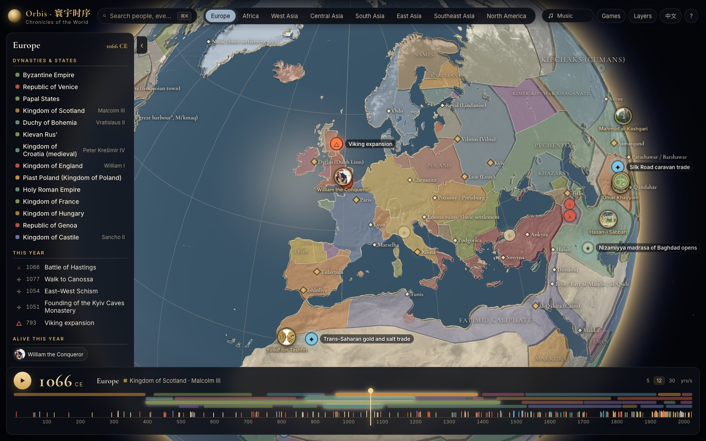](https://atlas.anyloop.ai/?year=1066)

## See it in motion

| A tour of the globe | A life's journey | Mini-game: Red Cliffs |
| --- | --- | --- |
| [](docs/readme/tour.mp4) | [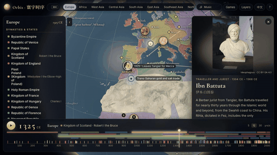](docs/readme/journey.mp4) | [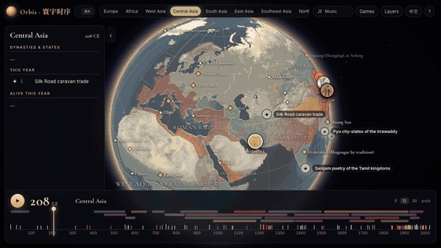](docs/readme/game-red-cliffs.mp4) |
| The intro swing, a flight to Europe, 30 years a second of the timeline, then on to East Asia. [MP4](docs/readme/tour.mp4) | Ibn Battuta's travels, one stop at a time; the year and the camera follow. [MP4](docs/readme/journey.mp4) | Sail the fire ships of Red Cliffs on the wind and light them at the right moment. [MP4](docs/readme/game-red-cliffs.mp4) |

The GIFs are short previews. Click one to open the full-quality MP4.

## What's in it

1,590 events, 591 people, 289 places and 517 polities, each checked against Wikidata
(see [Data & authenticity](#data--authenticity)).

### The globe and its regions

A three.js globe drawn as an engraved atlas: parchment land with hill-shading, ink-blue seas,
gold coastlines and a graticule. Polities are raised, colour-keyed caps, and each lineage keeps
its colour as its borders move (Rome → Byzantium; Han → Tang → Ming → Qing).

There are eleven regions in the top bar: **Europe · Africa · West Asia · Central Asia ·
South Asia · East Asia · Southeast Asia · North America · Mesoamerica · South America · Oceania**.
Click one and the camera flies there on a great-circle arc. You can also drag the globe freely; the
region, its side panel and its music follow whatever is under the camera.

| Mesoamerica, 1500 | South America, 1530 | Oceania, 1800 |
| --- | --- | --- |
| 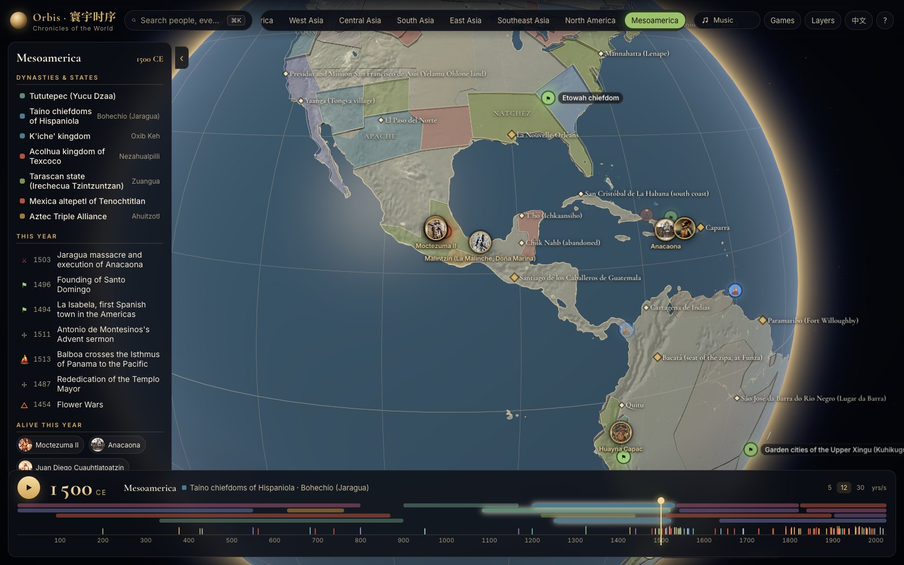 | 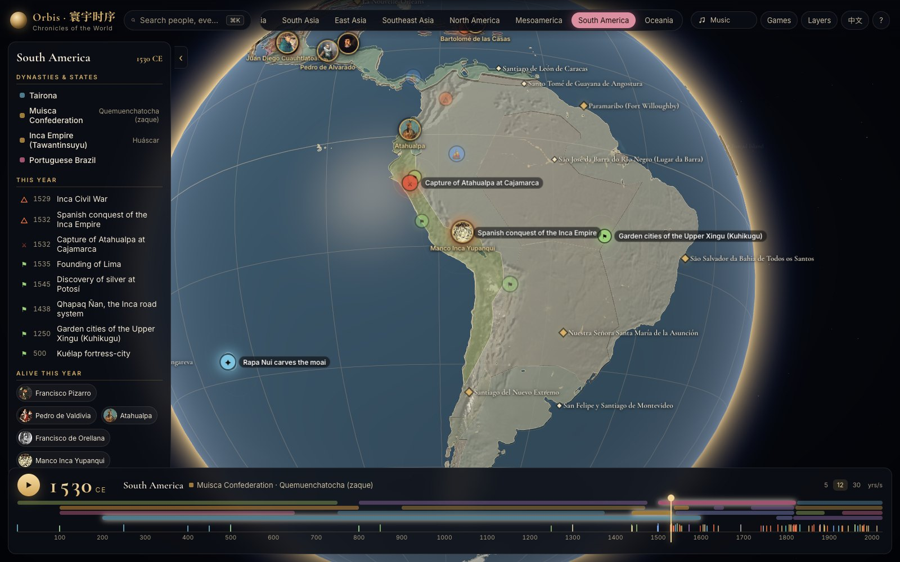 | 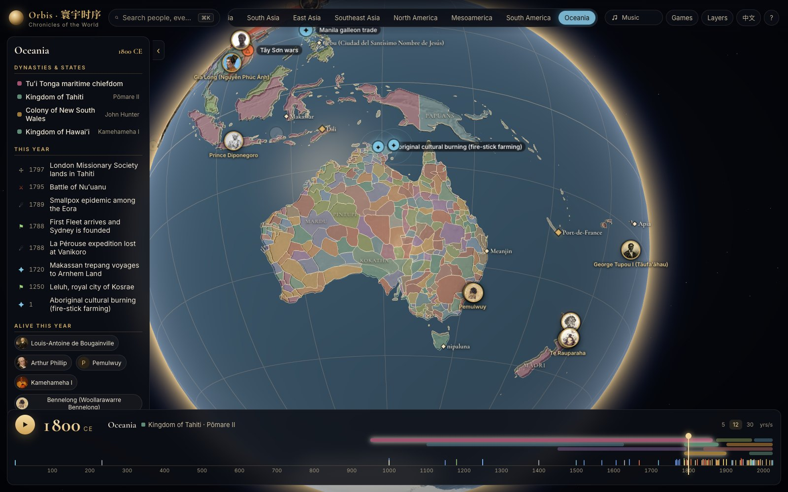 |

### The timeline

Scrub or play from 1 CE to 2025 at 5, 12 or 30 years per second. The timeline shows:
- dynasty bands for the region you are looking at;
- a tick for every event;
- the ruler reigning that year.

Borders come from 38 historical snapshots and switch as you pass each one.

### The region panel

The left panel lists the region's **dynasties and states** in the current year, with their rulers.
It also shows **this year's events** and the people **alive this year**. Every row opens that
record's card. The panel folds away with its ‹ button.

### Events and campaign routes

Events cover battles and wars, foundings and falls, treaties, religion, science, exploration and
disasters. Pins glow around their year. Wars and expeditions draw their campaign routes across
the map.

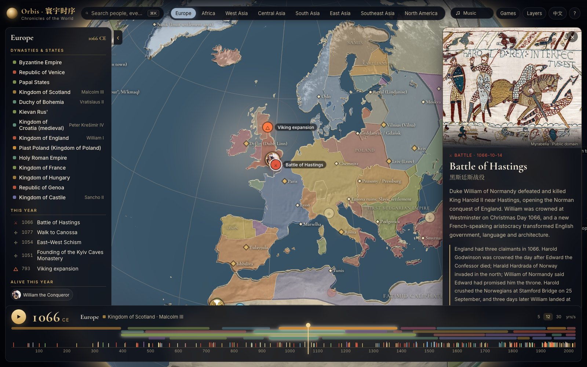

### People and their journeys

Portraits stand on the globe where each person was in the current year. Opening a biography draws their
numbered journey. Step through it with **‹ ›** or the arrow keys, and the year and the camera follow
each stop.

| Ibn Battuta, 1332 | Napoleon enters Moscow, 1812 |
| --- | --- |
| 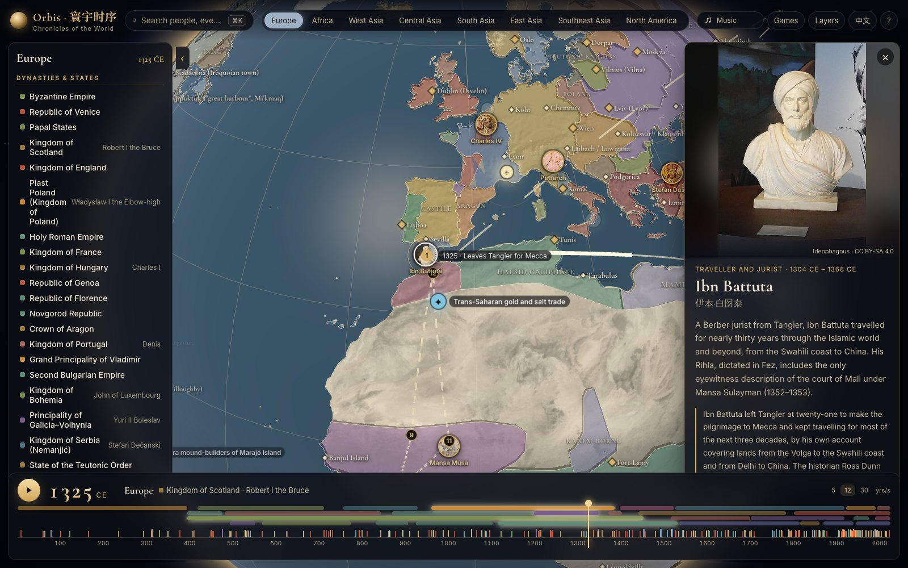 | 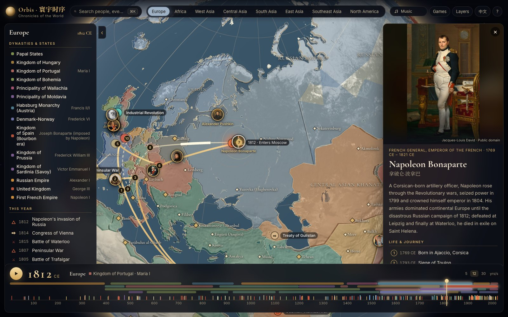 |

### Places and the genealogy of names

City labels change as you scrub. A place's card lists every historical name with its dates,
the polity that ruled the city, its spells as a capital, and the events that happened there.

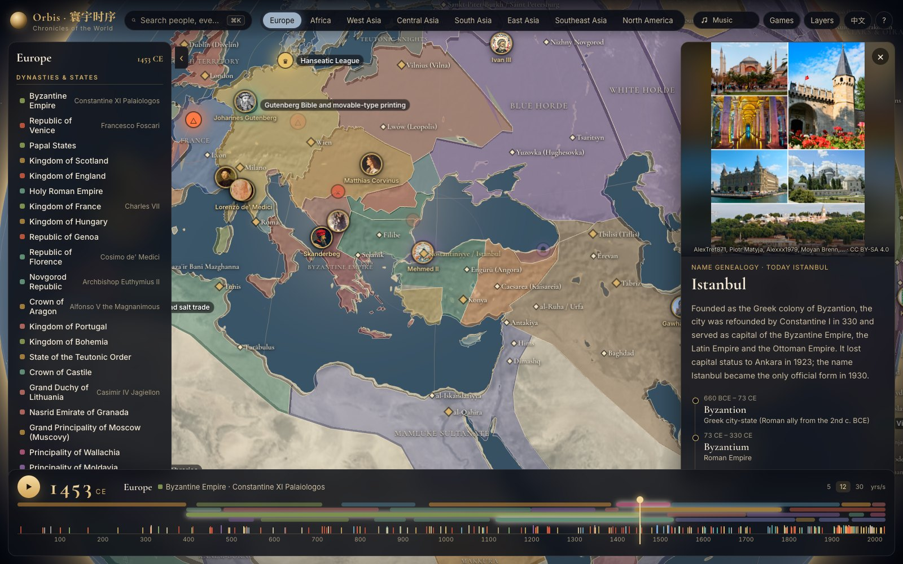

### Stories, pictures and sources

Each card has a short summary and, for most records, a longer **story**: anecdotes, context
and consequences. Pictures come from Wikimedia Commons with their author and license underneath.
Click a picture to see it full size in a viewer. Every card lists its sources.

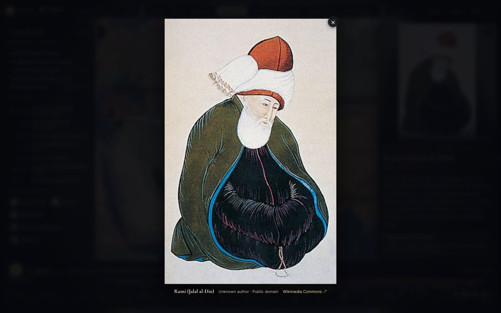

### Search

Press **⌘K** or **/** to search, in English or Chinese, across:
- people and events;
- polities and their rulers;
- places under any of their historical names.

Choosing a result opens its card and flies the globe there. Type a year, such as `1453`, to jump
straight to it.

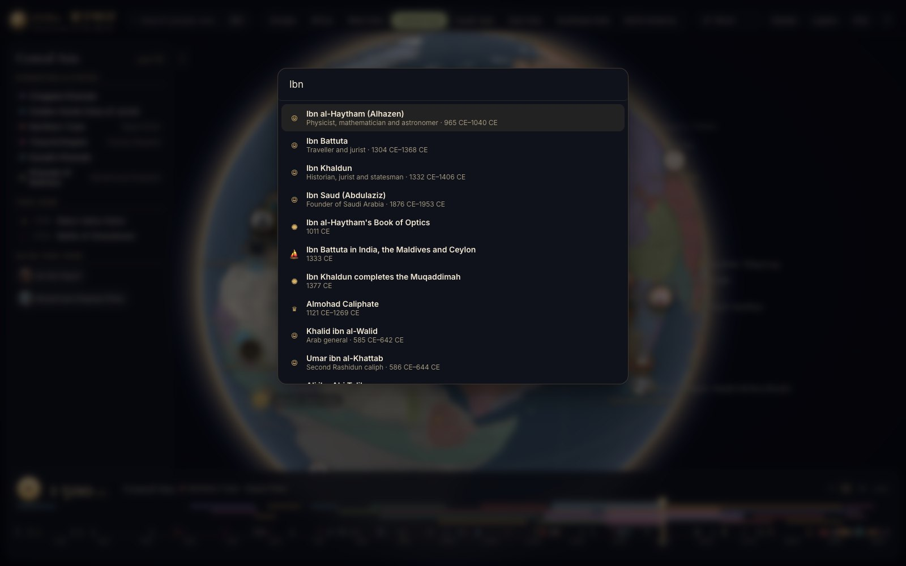

### Layers

Turn the map's layers on and off: **borders, labels, events, people and places**.

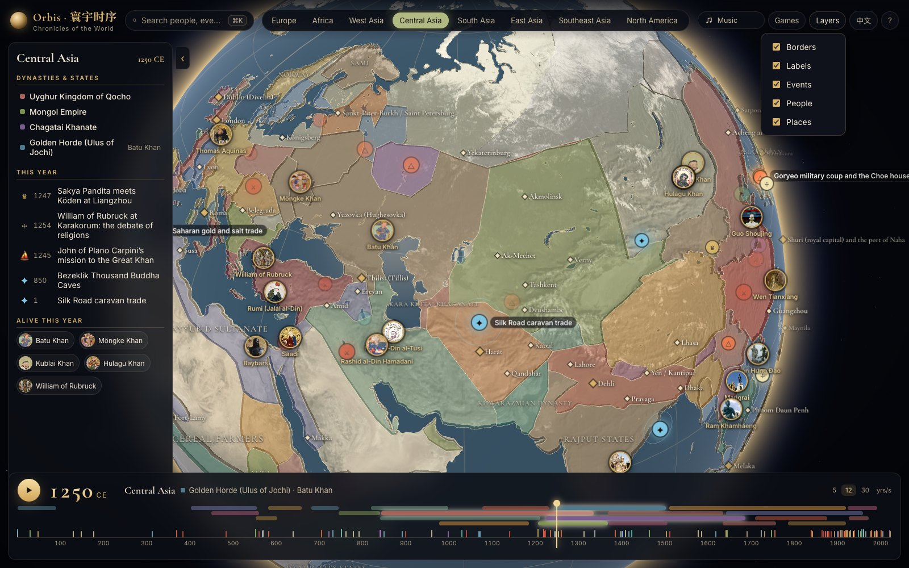

### Music

There is an original instrumental score for every region, plus an open-sea track:
- **Europe:** lute, viol and harp.
- **Africa:** kora and balafon.
- **West Asia:** oud and ney.
- **Central Asia:** dombra and horse-head fiddle.
- **South Asia:** sitar over tanpura.
- **East Asia:** guzheng and dizi.
- **Southeast Asia:** gamelan and suling flute.
- **North America:** cedar flute and frame drum.
- **Mesoamerica:** clay flutes and teponaztli.
- **South America:** siku panpipes and charango.
- **Oceania:** didgeridoo and clapsticks.

Each region has two takes that alternate without a gap. When the region under the camera changes,
the music crossfades. The top bar names what is playing, and the phone's media controls can
pause it. The tracks were generated with ElevenLabs Music via WaveSpeed.

### Mini-games

Some records have a hand-made mini-game: open one from **Games** in the top bar, or with the
**Play** button on its card. Each game starts with the story and ends with a history panel on what
really happened.

| Red Cliffs · The East Wind (208) | Vostok 1 · Into Orbit (1961) | Orchid Pavilion · The Brush (353) |
| --- | --- | --- |
| 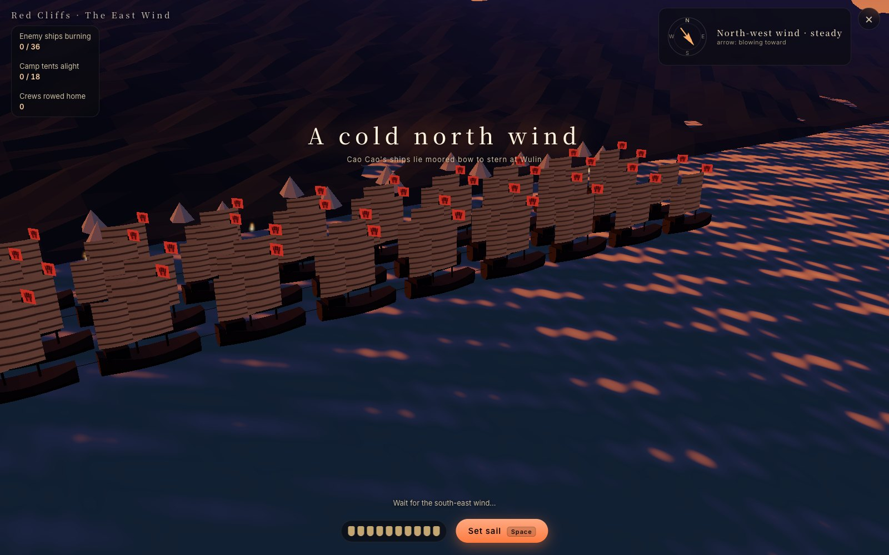 | 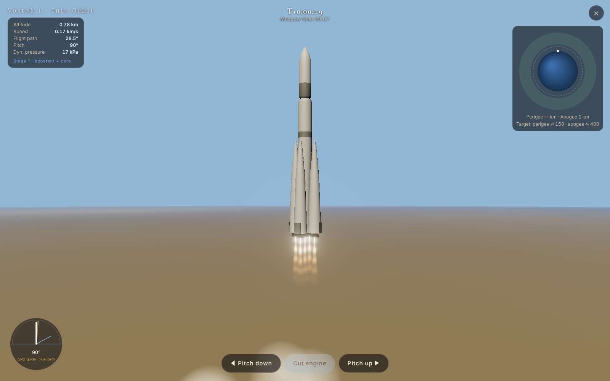 | 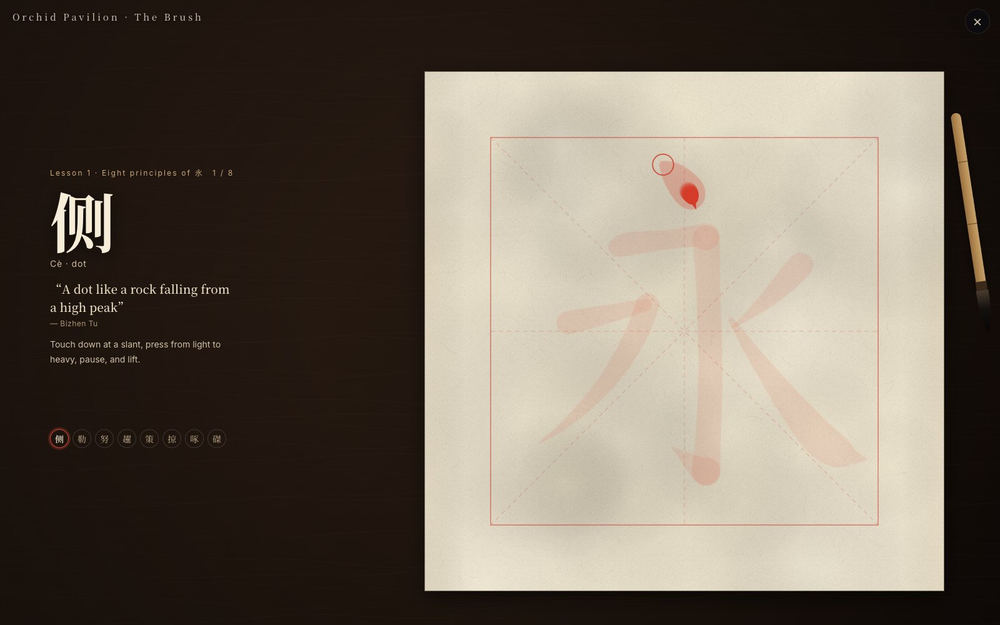 |
| Wait for the south-east wind, sail Huang Gai's fire ships at Cao Cao's fleet and light them about two li out. | Fly Gagarin's R-7 into orbit: pitch it over, then cut the engine at the right moment to reach the target orbit. | Learn the eight basic strokes of 永. Drag slowly for heavy, wet ink, or fast for a thin, dry brush. |

**Brush Isles** is an island-building game in four places and periods. You never place a house:
you paint land out of the water, then paint where the town, fields and trees should go, and the
city grows in that place's own style. It has houses that turn to face the canals, bridges over
narrow water, chinampas or polder windmills, and one landmark to crown it. The fourth city is
Tenochtitlan (1325), grown out of Lake Texcoco on chinampas around the Templo Mayor.

| Bianjing (c. 1100) | Raʻiatea (c. 1000) | Amsterdam (1600s) |
| --- | --- | --- |
| 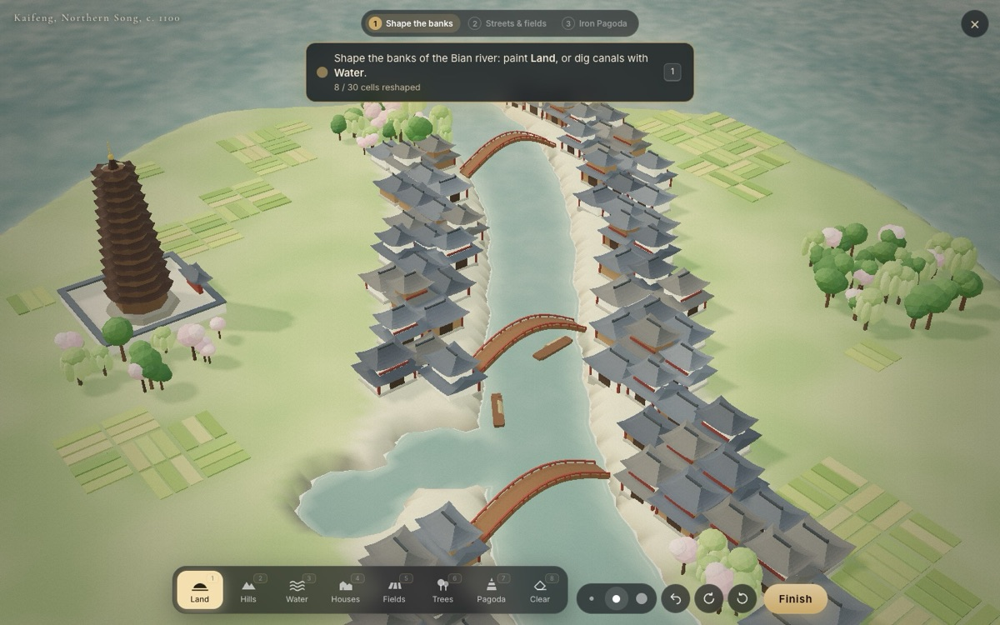 | 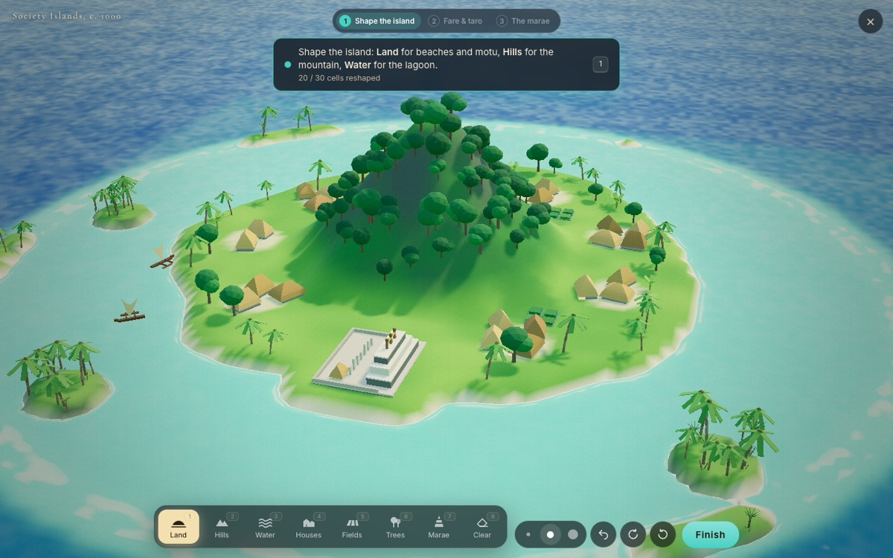 | 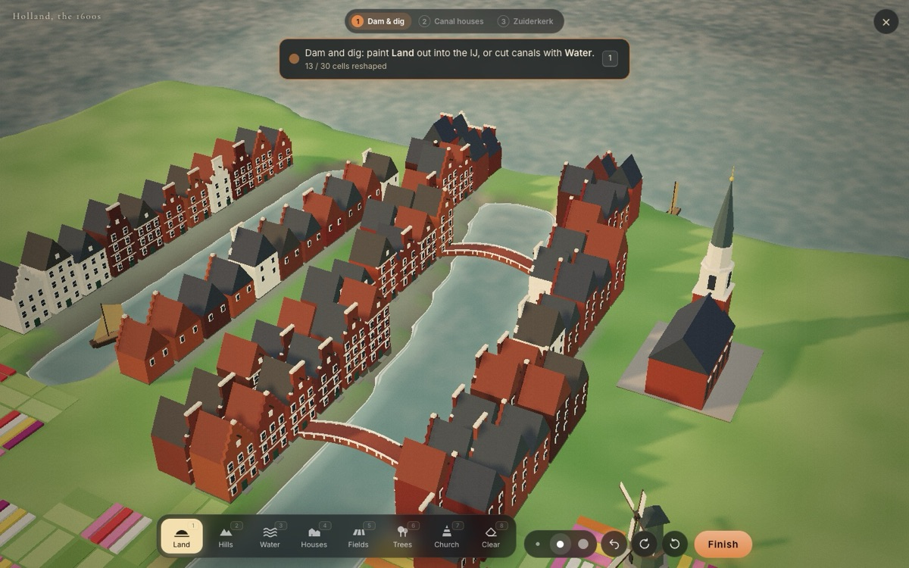 |
| Build the Song capital along the river of the Qingming scroll: tiled roofs, willows, rainbow bridges and the Iron Pagoda. | Shape a high island and its reef lagoon, with fare houses, taro and the marae of Taputapuātea. | Dam and dig a Golden Age canal city with stepped gables, polders and windmills. |

### Two languages

The whole interface, and every record, is in English and 简体中文. The atlas follows your browser's
language. Switch with **中文 / EN**, or add `?lang=zh` to the link.

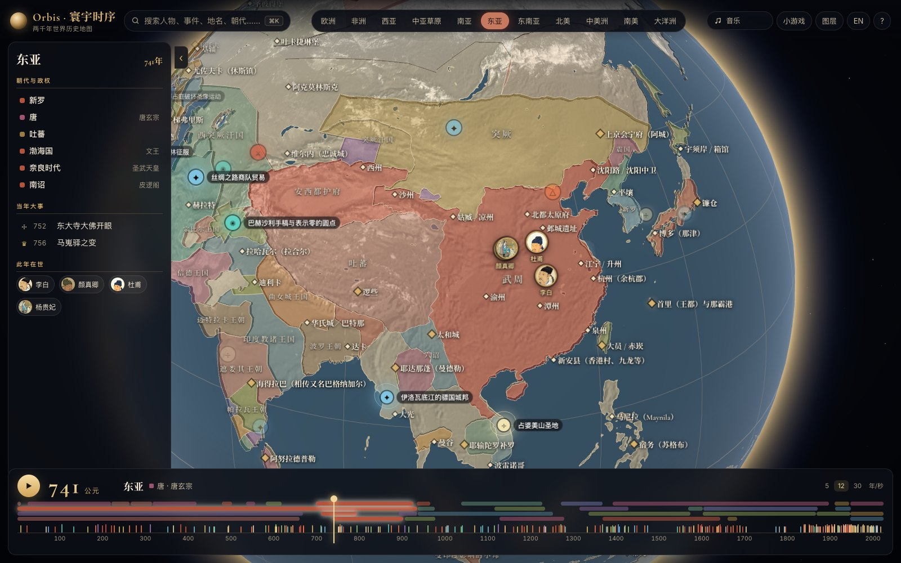

### Links you can share

The address bar follows what you are looking at, so any view can be shared:

- **The year:** `?year=1453`
- **The language:** `&lang=zh`
- **An open card:** `&event=ev-battle-of-hastings`, `&person=person-ibn-battuta`, `&place=place-istanbul` or `&polity=…`

For example: <https://atlas.anyloop.ai/?year=1453&place=place-istanbul>

### Phone, keyboard and accessibility

The layout adapts to phones and tablets. Everything can be reached by keyboard and has
screen-reader labels. The atlas also respects your system's *reduce motion* setting: camera
flights become quick cuts.

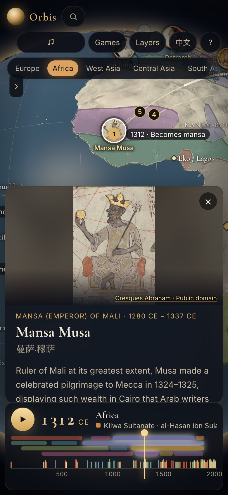

| Key | Action |
| --- | --- |
| `⌘K` or `/` | Search |
| `Space` | Play or pause the timeline |
| `←` `→` | Previous or next major event year, or journey stop when a biography is open (`Shift`: ±10 years) |
| `←` `→` `PgUp` `PgDn` `Home` `End` | On the focused timeline: ±1 year, ±100 years, first year, last year |
| `Esc` | Close |

## Data & authenticity

| Layer | Source | License |
| --- | --- | --- |
| World borders: 38 snapshots, 1 CE → 2010 | [aourednik/historical-basemaps](https://github.com/aourednik/historical-basemaps) | GPL-3.0 |
| China and its neighbours: polity outlines, dynasties, events, journeys, place names | Adapted from the China atlas credited under [Credits](#credits). Its prefecture layer is **not** used: the CHGIS terms forbid redistribution. | GPL-3.0 |
| Dates, coordinates, labels, portraits | [Wikidata](https://www.wikidata.org) | CC0 |
| Images | Wikimedia Commons, hot-linked thumbnails, with author and license under each image | per file |
| Earth textures | NASA Blue Marble and topography, via three-globe's examples | public domain |
| Music | Original, generated with ElevenLabs Music via WaveSpeed from the prompts in `music/prompts.json` | — |

Every curated record carries:
- its **Wikidata QID**;
- at least two **sources**, one of them not Wikipedia where possible;
- a **confidence** level.

Verification works in three steps:
1. The build compares every curated year and coordinate with Wikidata. It writes one report per
   dataset to [`data/verification/auto-diff/`](data/verification/auto-diff/).
2. Verifiers resolve each difference against a second independent source, in
   `data/verification/resolutions.json`.
3. Known errors in the border layer are fixed in `data/borders/corrections.json`.

The China area of every border snapshot is replaced with the outlines from the China dataset.
For example, the 1400 base snapshot still shows a Yuan "Great Khanate" over China, 32 years after
the Ming took over.

Borders are schematic reconstructions, not surveyed boundaries.

## Develop

```bash
npm install
npm run dev                         # http://localhost:5173
npm run build                       # static site in dist/
```

### Data pipeline

The Wikidata and Commons caches (`data/cache/<dataset>/`) and the verification reports are
committed. `public/data/atlas.json` and `stories.json` are build outputs: `npm run dev` and
`npm run build` regenerate them from the caches, offline.

```bash
node scripts/wd.mjs search "Battle of Hastings"   # find a QID
node scripts/wd.mjs lookup Q83224                  # Wikidata facts for a QID
node scripts/validate-data.mjs                     # schema and cross-reference checks
node scripts/wd.mjs enrich [dataset]               # fetch Wikidata/Commons facts into data/cache/<dataset>/
node scripts/build-data.mjs                        # → public/data/{atlas,stories}.json + auto-diff reports
node scripts/build-borders.mjs <historical-basemaps>/geojson <china-atlas-checkout>   # → public/data/borders
```

Curated data lives in `data/<dataset>/{events,people,places,polities}.json`; see
[`data/SCHEMA.md`](data/SCHEMA.md). The project plan is in [`docs/PLAN.md`](docs/PLAN.md).

### Music

```bash
node scripts/gen-music.mjs --only europe --force   # regenerate a region (providers and keys: script header)
.venv-aes/bin/python scripts/score-music.py         # rate takes with Meta's Audiobox Aesthetics model (setup: script header)
```

When choosing between takes, keep the one with the higher "content enjoyment" score. The procedural
Web Audio score in `src/audio/MusicEngine.ts` is only a fallback, for builds without tracks.

### Checks and screenshots

```bash
npm run shots                         # smoke test + screenshots
node scripts/check-music.mjs          # tracks, loop seams, crossfades (BROWSER=webkit for Safari's engine)
node scripts/check-topbar.mjs         # the top bar fits from 1920 px down to 390 px
node scripts/shots-portraits.mjs      # card pictures are never cropped
node scripts/shots-readme.mjs         # the screenshots and videos in this README
```

### Deploy

The site runs on Railway at **atlas.anyloop.ai**: a Docker build, served by Caddy
(`Dockerfile`, `Caddyfile`, `railway.json`). Railway is not connected to this repository, so deploy
from `main` by hand:

```bash
railway up
```

`.github/workflows/pages.yml` can also build a GitHub Pages copy of the site, but only when run by
hand.

## Credits

The Chinese data (dynasties, polity outlines, events, journeys and the genealogy of place names)
is adapted, under GPL-3.0, from **[江山时序 jiangshan-map](https://github.com/DeanChensj/jiangshan-map)** by DeanChensj. The `build-borders.mjs` step above takes a
checkout of it as its second argument.

Thanks also to:
- [historical-basemaps](https://github.com/aourednik/historical-basemaps) for the world borders;
- [Wikidata](https://www.wikidata.org) and [Wikimedia Commons](https://commons.wikimedia.org) for facts and images;
- NASA for the Blue Marble textures;
- [three-globe](https://github.com/vasturiano/three-globe) for the globe.

## Author

Made by **Iris**: [X @iris_ye_tu](https://x.com/iris_ye_tu) · [adant.ai](https://adant.ai)

## License

Open source under GPL-3.0; the full text is in [`LICENSE`](LICENSE). The project is GPL-3.0
because it adapts GPL-3.0 data from historical-basemaps and 江山时序 jiangshan-map.

When you reuse maps or screenshots, credit Orbis, [江山时序 jiangshan-map](https://github.com/DeanChensj/jiangshan-map)
and [historical-basemaps](https://github.com/aourednik/historical-basemaps).
